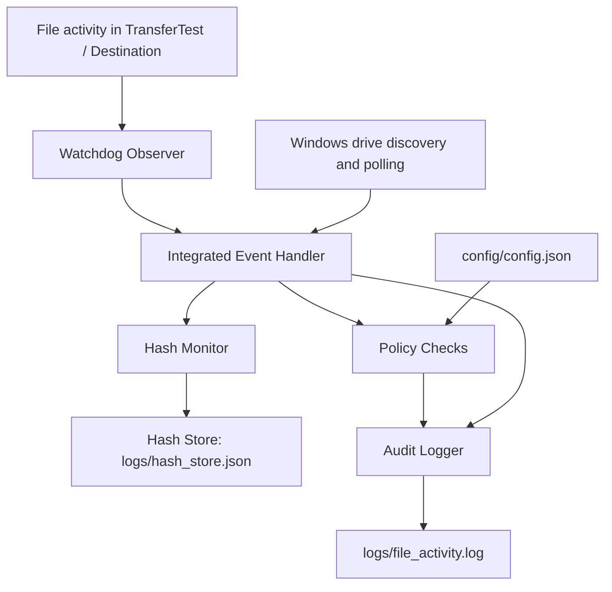

# Secure File Transfer Monitoring System

A Windows-based prototype for monitoring selected folders, recording file activity, maintaining file-integrity baselines, and alerting on configured security-policy conditions.

> **Project status:** Working prototype with manually demonstrated monitoring, hashing, rename-baseline migration, integrity-change detection, sensitive-path alerts, suspicious-extension alerts, and an allowed test destination. Policy handling is **alert-only**; it does not prevent or block file operations.

## 1. Overview

The system watches two project test folders recursively:

- `TransferTest` - the controlled source/staging test folder.
- `Destination` - the permitted destination test folder.

It uses Watchdog to receive filesystem events and Windows drive APIs through `pywin32` to discover drives and identify drive types. File hashes are calculated with SHA-256 and MD5 and stored in a JSON baseline store. Activity and policy events are written to a structured text log.

## 2. Main features

- Detect file creation, modification, deletion, and filesystem move/rename events in the monitored folders.
- Calculate SHA-256 and MD5 baselines for accessible files using chunked reads.
- Compare current hashes with stored baselines and report integrity changes.
- Migrate a stored baseline when Watchdog reports a rename/move event and the source baseline is available.
- Detect activity involving configured sensitive paths.
- Alert when filenames use configured suspicious extensions such as `.exe`, `.bat`, `.cmd`, `.ps1`, `.vbs`, `.js`, and `.scr`.
- Check configured restricted destinations and the allowed test destination.
- Discover Windows drives and poll for drive connection/removal changes; removable drives are identified by drive type.
- Record structured events in `logs/file_activity.log` and hashes in `logs/hash_store.json`.
- Filter common temporary/system noise and debounce repeated modification notifications.

## 3. Architecture



The monitor is intentionally scoped to the project test folders. In the demonstrated setup the project is on `D:`; other drives may be discovered for status reporting, but their file contents are skipped.

## 4. Project structure

```text
fileMonitorLab/
├── config/
│   └── config.json
├── Destination/
├── evidence/
├── logs/
│   ├── file_activity.log
│   └── hash_store.json
├── reports/
├── src/
│   ├── drive_monitor.py
│   ├── drive_watcher.py
│   ├── file_monitor.py
│   ├── hash_monitor.py
│   ├── hash_store.py
│   ├── integrated_monitor.py
│   ├── logger.py
│   └── main.py
├── tests/
└── TransferTest/
```

`integrated_monitor.py` is the primary integrated entry point. The other monitor modules are retained as standalone utilities/tests or supporting modules. The active launch command is run from `src`.

## 5. Requirements

- Windows 10/11 (the implementation uses Windows drive APIs).
- Python 3.x.
- Python packages: `watchdog` and `pywin32`.

Install dependencies from the project root:

```cmd
python -m pip install -r requirements.txt
```

If a requirements file has not yet been added, install directly:

```cmd
python -m pip install watchdog pywin32
```

## 6. Configuration

Edit `config/config.json`. The current test configuration should resemble:

```json
{
  "monitoring": {
    "enabled": true,
    "hash_algorithms": ["sha256", "md5"]
  },
  "sensitive_paths": [
    "D:\\fileMonitorLab\\TransferTest"
  ],
  "restricted_destinations": [],
  "allowed_destinations": [
    "D:\\fileMonitorLab\\Destination"
  ],
  "suspicious_extensions": [
    ".exe", ".bat", ".cmd", ".ps1", ".vbs", ".js", ".scr"
  ],
  "alerts": {
    "enabled": true,
    "log_policy_violations": true
  }
}
```

Update the absolute paths if the project is stored somewhere other than `D:\fileMonitorLab`.

### Policy meaning

| Setting | Purpose |
|---|---|
| `monitoring.enabled` | Enables or disables the integrated monitor. |
| `sensitive_paths` | Paths where observed file activity should generate a sensitive-path alert. |
| `restricted_destinations` | Destinations where observed file activity should generate a restricted-destination alert. |
| `allowed_destinations` | Approved destinations used by the current destination-policy check. |
| `suspicious_extensions` | File extensions that generate an alert. |
| `alerts.enabled` | Master switch for policy alerts. |
| `alerts.log_policy_violations` | Enables printing/logging of policy violations. |

The `hash_algorithms` key is present in the configuration, but the current hashing helper calculates both SHA-256 and MD5 directly; the list is not a dynamic algorithm selector in the current implementation.

## 7. Run the system

Open Command Prompt and run:

```cmd
cd /d D:\fileMonitorLab\src
python main.py
```

The monitor prints the initial drive discovery, starts observers on the existing `TransferTest` and `Destination` folders, and checks for drive changes approximately every two seconds. Press `Ctrl+C` to stop monitoring cleanly.

## 8. Manual validation

The following behaviours were manually demonstrated during the project test session on 24 November 2026:

| Test | Procedure | Observed result |
|---|---|---|
| File creation and hashing | Create a text file in `TransferTest`. | `[CREATED]` followed by `[HASHED]`. |
| Rename detection | Rename a previously hashed file inside `TransferTest`. | `[MOVED]` and `[BASELINE MOVED]`. |
| Integrity change | Modify and save the renamed file. | `[INTEGRITY CHANGED]`; SHA-256 and MD5 comparisons were `False`. |
| Sensitive-path alert | Create or rename a file under configured `TransferTest`. | `SENSITIVE_PATH_ACTIVITY`. |
| Suspicious extension | Rename a test file to `.ps1` (do not execute it). | `SUSPICIOUS_FILE_EXTENSION`. |
| Allowed test destination | Copy a file from `TransferTest` into `Destination`. | Source `DELETED`, destination `CREATED` and `HASHED`; no unapproved-destination alert was observed. |
| Hash-store function checks | Run `python hash_store.py`. | Storage, retrieval, rename migration, and removal tests reported PASS. |

These are manual checks, not a claim that an automated regression test suite is included.

## 9. Logs and data

- `logs/file_activity.log` - timestamped activity, policy, drive, and system events.
- `logs/hash_store.json` - file-path keyed SHA-256/MD5 baseline records and storage timestamps.

Keep the hash store and logs when collecting evidence. Do not edit the baseline JSON manually during integrity tests.

## 10. Important limitations

1. **Alert-only policy model:** the prototype records policy alerts but does not stop, quarantine, or deny file operations.
2. **Limited scope:** only `TransferTest` and `Destination` are watched recursively in the current test configuration. Other drive contents are not monitored.
3. **No process/user attribution:** log fields exist for user/process values, but the current event source does not identify the originating process or user; these values remain `N/A` unless a separate telemetry source is added.
4. **Cross-folder/cross-volume correlation:** a copy followed by deletion may be reported as separate `CREATED` and `DELETED` events, not as one correlated transfer. In the demonstrated `TransferTest` to `Destination` case, the destination file received a new baseline; the original baseline was not migrated across that copy/delete sequence.
5. **Rename migration depends on a move event:** a baseline can be migrated when the observer supplies a corresponding move/rename event and a source baseline exists.
6. **MD5 is not a modern security-strength integrity primitive:** SHA-256 should be treated as the primary integrity digest; MD5 is retained as a secondary comparison in this prototype.
7. **Policy coverage:** sensitive paths, suspicious extensions, and the configured allowed destination were manually exercised. Restricted-destination behaviour was not demonstrated in the recorded test session.
8. **Configuration limitation:** the configured hash algorithm list is not currently used to select arbitrary algorithms dynamically.

## 11. Future improvements

- Add Windows process/user attribution with an appropriate Windows auditing or ETW-based event source.
- Improve transfer correlation across copy/delete and different volumes, for example by correlating stable file identifiers, content hashes, size, and time windows.
- Implement OS-level enforcement or controlled transfer workflows if actual blocking is required.
- Make `hash_algorithms` configuration drive the hash implementation.
- Add automated unit/integration tests for policy matching, paths, rename events, and error cases.
- Strengthen baseline storage, backup, permissions, retention, and concurrency handling.
- Add report export, a simple dashboard, and configurable monitoring scopes.

## 12. Troubleshooting

**No policy alert appears:** confirm the JSON path being loaded is `config/config.json`, confirm the relevant list is populated, and confirm `alerts.enabled` and `alerts.log_policy_violations` are both `true`.

**A `.ps1` test is not detected:** in File Explorer enable **View → Show → File name extensions** and verify the filename ends in `.ps1`, not `.ps1.txt`. Do not execute test scripts.

**Monitoring does not start:** check the Python packages, confirm the two test folders exist, and run `python main.py` from the `src` directory.

**Integrity result is `NO BASELINE`:** the file path may not have a stored baseline, the event may be a copy/create rather than a rename/move, or the baseline store may have been reset. Check `logs/hash_store.json`.

---

## Project submission note

Before submission, replace any personal/institutional placeholders in the accompanying report, capture screenshots from the final local run, and include the actual `config/config.json`, `logs` evidence (after removing unrelated/private data), and source files. Do not claim blocking, process attribution, full-volume monitoring, or cross-volume transfer correlation unless those features are implemented and separately tested.
